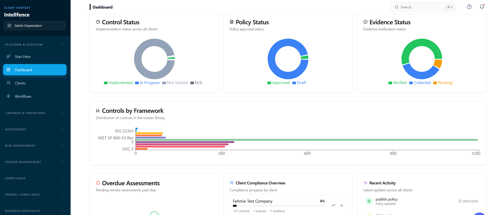
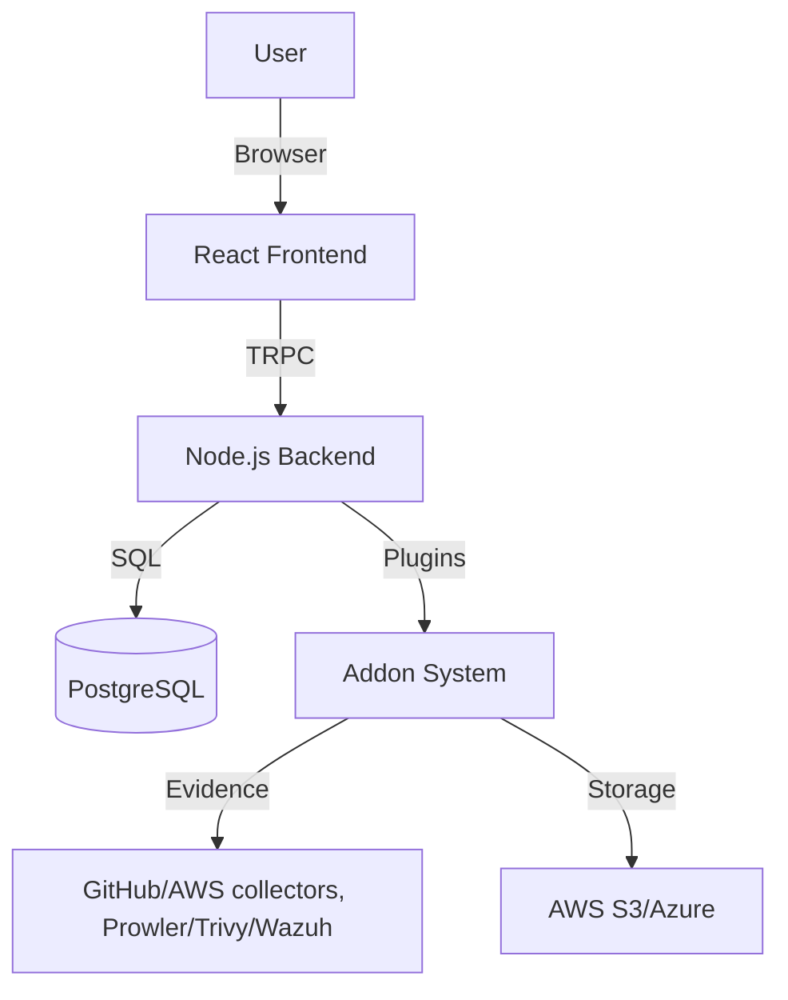

# ComplianceOS

<div align="center">



**SOC 2, ISO 27001, HIPAA, PCI DSS, NIST 800-53 / 800-171 (CMMC), NIS2, FedRAMP and privacy programs — in one self-hosted install.**

[](./LICENSE)
[](https://github.com/Sectutor/ComplianceOS/actions/workflows/ci.yml?query=branch%3Acoolify-deploy-buildall)
[](https://github.com/Sectutor/ComplianceOS)
[](https://www.typescriptlang.org/)
[](https://reactjs.org/)
[](http://makeapullrequest.com)

```bash
# ⚡ 60-Second One-Line Docker Install (Linux & macOS)
curl -fsSL https://grcompliance.com/install.sh | bash
```

[Quickstart](#-getting-started) • [Features](#-key-features) • [Why ComplianceOS?](#-why-complianceos) • [Architecture](#-architecture) • [Contributing](#-contributing)

</div>

---

## 🚀 Overview

**ComplianceOS** (formerly GRCompliance) puts your whole framework portfolio in **one self-hosted install** on your own infrastructure: no per-seat pricing, and your compliance data stays on your infrastructure.

Framework content that ships in the repo (`packages/core/src/data/frameworks`, `packages/core/src/data/regulations`):

- **Security:** SOC 2, ISO 27001 (2013 & 2022), ISO 22301, HIPAA, PCI DSS, CIS Controls, HITRUST, Cyber Essentials, NIST AI RMF
- **Federal / defense:** NIST 800-53 Rev 5, FedRAMP, NIST 800-171 with SPRS score weighting for **CMMC** readiness, SSP and POA&M tooling
- **EU:** **NIS2** (entity classification wizard, control health, incident-reporting clock, audit bundle generator)
- **Privacy:** GDPR assessment plus ROPA, DSAR and DPIA workflows; UK GDPR, LGPD, PIPEDA, APPI, ISO 27701 and US state privacy laws

Evidence: **GitHub & AWS evidence collectors + open-source scanner add-ons (Prowler, Trivy, Wazuh)**, plus manual uploads.

## ✨ Key Features

### 🛡️ Unified Control Framework
Define your controls once and map them to multiple standards automatically.
- **Multi-Framework Support**: SOC 2, ISO 27001, HIPAA, PCI DSS, NIST 800-53, NIST 800-171 / CMMC, NIS2, FedRAMP and GDPR (see Overview).
- **Smart Mapping**: Our "Mesh" architecture ensures that one implemented control satisfies requirements across multiple frameworks.
- **Harmonization**: Automatically identify overlapping requirements to reduce audit fatigue.

### 📊 Automated Risk Management
Move beyond static risk registers with a dynamic, ISO 31000-aligned risk engine.
- **Visual Heatmaps**: Real-time visualization of your risk landscape.
- **Asset-Based Risk**: Link risks directly to your assets, vendors, and processes.
- **Treatment Plans**: Track remediation tasks and accept, transfer, or mitigate risks with audit trails.

### 🔌 Modular Addon System
Extensible architecture allowing you to connect your favorite tools.
- **Evidence**: GitHub & AWS evidence collectors + open-source scanner add-ons (Prowler, Trivy, Wazuh).
- **Storage Providers**: Bring your own storage (AWS S3, Azure Blob, Google Cloud).
- **Templates**: Marketplace for policy packs and assessment templates.
- **Developer Friendly**: easy-to-use API for building your own [Custom Addons](./docs/ADDON_SYSTEM.md).

### 🏢 Business Continuity & Disaster Recovery
Built-in tools to keep your business running during disruptions.
- **BIA (Business Impact Analysis)**: Calculate RTOs and RPOs with guided workflows.
- **Recovery Plans**: Create and test actionable disaster recovery plans.
- **Call Trees**: Manage emergency contacts and communication protocols.

### 🔍 Audit Hub
Streamline your external audits.
- **Evidence Collection**: Centralized repository for all compliance evidence.
- **Auditor Access**: specific views for auditors to review controls without accessing sensitive internal data.
- **Snapshotting**: "Freeze" your compliance state for point-in-time audits.

### 🔒 Privacy Center
Manage your data privacy obligations in one place.
- **ROPA**: Record of Processing Activities generator.
- **DSAR Management**: Workflow for handling Data Subject Access Requests.
- **DPIA**: Data Protection Impact Assessments for high-risk processing.

### 🏛️ Federal & Government Compliance
Dedicated tools for defense contractors and federal agencies.
- **NIST 800-171 / CMMC**: Specialized workflows for CMMC readiness.
- **SSP Editor**: Generator for System Security Plans.
- **POAM Tracker**: Plan of Action and Milestones tracking for federal audits.
- **FIPS 199**: Categorization wizard for federal information systems.

### 🤝 Third-Party Risk Management (TPRM)
End-to-end vendor risk lifecycle management.
- **Vendor Onboarding**: Workflows for assessing and onboarding new vendors.
- **Security Reviews**: Automated questionnaires and risk scoring.
- **Contract Management**: Track DPAs (Data Processing Agreements) and security addendums.
- **Vendor Catalog**: Centralized database of all third-party suppliers.

### 🛡️ Cyber Resilience
Prepare for and respond to cyber incidents.
- **Incident Reporting**: Centralized logging and tracking of security incidents.
- **Cyber Assessments**: Regular maturity assessments against cyber frameworks.


## ⚖️ Editions & Pricing
ComplianceOS is **open core**. Same price for internal teams and consultants, no per-seat fees. Current prices and the founding-member offer: **[grcompliance.com/pricing](https://grcompliance.com/pricing.html)**.

| Edition | Price | What you get |
| :--- | :---: | :--- |
| **Community** | Free (AGPLv3) | Core GRC modules (risks & policies), standard framework controls, single-command Docker deploy, 1 workspace, community GitHub support |
| **Professional** | $1,990 / year | Unlimited workspaces, all frameworks, GitHub & AWS evidence collectors + scanner add-ons, vendor risk, AI policy generator & questionnaire responder, white-label reports, 1 year of updates & priority support |
| **Lifetime** | $4,990 one-time | Everything in Professional, lifetime software updates, 1 year of priority support |
| **Enterprise** | From $9,990 / year | Tailored deployment (incl. air-gapped) — [contact via the pricing page](https://grcompliance.com/pricing.html) |

Optional services: Standard Install $499 · Secure Install $1,490 · 45-day Audit Ready Sprint $12,900 + license. Founding members get 20% off licenses for the first 30 days (Professional $1,592/yr, Lifetime $3,992).

### 🎓 The "Feature Graduation" Philosophy
We use a time-delayed open source model. New, cutting-edge features (like AI Governance or new Federal standards) are initially released to **Premium** users to fund development. After a stabilization period (typically 3-6 months), these features are "graduated" into the **Community** edition, ensuring the open source platform gets more powerful over time.

## 🏆 Why ComplianceOS?

| Metric | 🚀 ComplianceOS | 📉 Spreadsheets | 🏢 Commercial (Vanta/Drata) |
| :--- | :---: | :---: | :---: |
| **Cost** | **Free Community / from $1,990 per year** | Free | ~$12,000–$28,000 / year |
| **Data Privacy** | **On-Prem / Private Cloud** | Local Files | Third-Party SaaS |
| **Customization** | **Full Code Access** | High | Rigid |
| **Vendor Lock-in** | **None (Open Data)** | None | High |
| **Speed** | **Instant Setup** | Manual | Weeks of Sales Calls |

## 🏗️ Architecture



## 🛠️ Tech Stack

ComplianceOS is built with a modern, type-safe stack designed for performance and developer experience.

- **Frontend**: React 18, TypeScript, Tailwind CSS, Shadcn UI
- **Backend**: Node.js, Express
- **API**: TRPC (End-to-end type safety)
- **Database**: PostgreSQL
- **ORM**: Drizzle ORM
- **Authentication**: JWT / OAuth2

## 🚀 Getting Started

### ⚡ One-Command Install (Production Docker Stack)

**Linux & macOS:**
```bash
curl -fsSL https://grcompliance.com/install.sh | bash
```

**Windows (PowerShell):**
```powershell
irm https://raw.githubusercontent.com/Sectutor/ComplianceOS/coolify-deploy-buildall/install.ps1 | iex
```

This starts PostgreSQL, Redis, and ComplianceOS on port `3002`, auto-generates your production encryption keys, and initializes your admin account.

**Visit http://localhost:3002** to log in:
- **Email:** `admin@complianceos.local`
- **Password:** Printed in your terminal during install (or the value set in `.env`)

---

### 💻 Developer & Bare-Metal Setup (Node.js)

```bash
# 1. Clone repository
git clone https://github.com/sectutor/ComplianceOS.git
cd ComplianceOS

# 2. Install dependencies
npm install

# 3. Launch 60-second Quickstart
npm run quickstart
```

Open [http://localhost:5173](http://localhost:5173) in your browser.

See the complete [**60-Second Onboarding Guide**](./docs/QUICKSTART.md) for step-by-step framework configuration.

---

### Production Deployment (canonical path)

Docker is the supported deployment: use `install.sh` (or `docker-compose.selfhost.yml`)
as described above. It runs PostgreSQL + Redis + ComplianceOS as a single stack,
pulling `ghcr.io/sectutor/complianceos-self-hosted` and building from source
automatically if the prebuilt image is unavailable.

**Build from source with Compose:**

```bash
git clone --branch coolify-deploy-buildall https://github.com/Sectutor/ComplianceOS.git
cd ComplianceOS
cp .env.example .env   # set ENCRYPTION_KEY, LOCAL_JWT_SECRET, SESSION_SECRET, admin credentials
docker compose -f docker-compose.selfhost.yml up -d --build complianceos db redis
```
 Other deployment artifacts in the repo
(Netlify, Vercel, Helm, Tauri) are community contributions and not part of the
tested release path.

## 📚 Documentation

Detailed documentation is available in the [`docs/`](./docs) directory:

- [**Addon Development Guide**](./docs/ADDON_SYSTEM.md)
- [**Strategic Differentiators**](./docs/STRATEGIC_DIFFERENTIATORS.md)
- [**Architecture Overview**](./docs/architecture.md)
- [**API Reference**](./docs/api-reference.md)
- [**Database Schema**](./docs/database-schema.md)

## 🤝 Contributing

We welcome contributions from the community! Whether it's fixing bugs, adding new frameworks, or building addons, your help is appreciated.

Please read our [Contributing Guide](./CONTRIBUTING.md) to get started.

## 📄 License

ComplianceOS uses a dual-licensing model:

### Community Edition (AGPLv3)
The core ComplianceOS platform is licensed under the **GNU Affero General Public License v3.0 (AGPLv3)**. This allows you to:
- Use, modify, and distribute the software for free
- Self-host for personal or business use
- Contribute improvements back to the community

**Important**: The AGPLv3 requires that if you modify the software and make it available as a network service, you must make your modifications available under the same license.

### Enterprise Edition (Commercial)
For organizations requiring advanced features, enterprise support, or commercial use rights, we offer a **Commercial License** that includes:
- AI-Powered Intelligence Suite
- Advisor & MSP Features (white-labeling)
- Enterprise Scalability
- Priority support
- Commercial use rights

For commercial licensing inquiries, see [grcompliance.com/pricing](https://grcompliance.com/pricing.html).

### License Files
- [AGPLv3 License](./LICENSE) - Community Edition
- [Commercial License Template](./LICENSE-COMMERCIAL.md) - Enterprise Edition

---

<div align="center">
  Built with ❤️ by the Open Source Security Community
</div>
